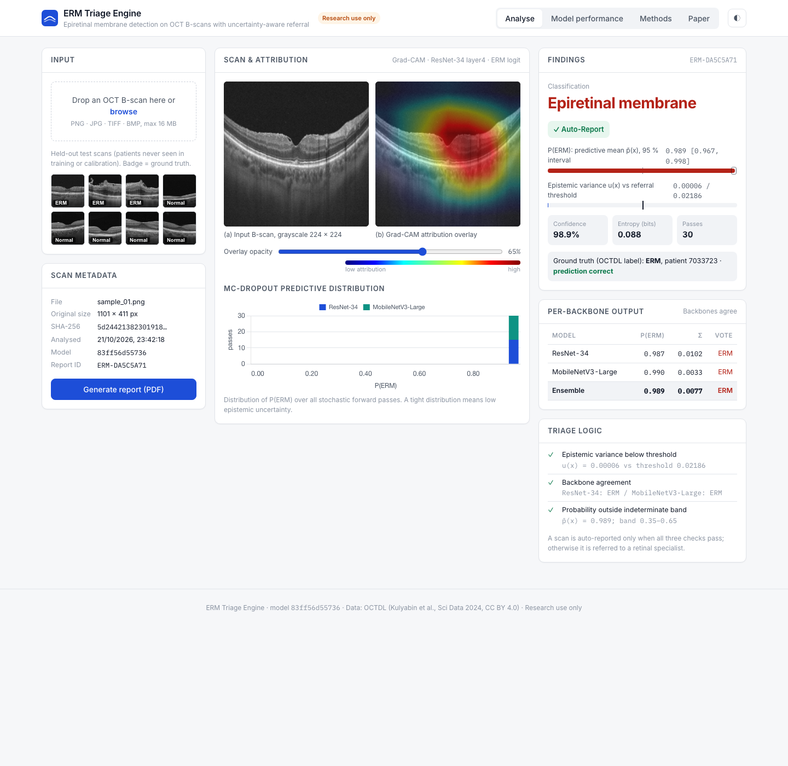
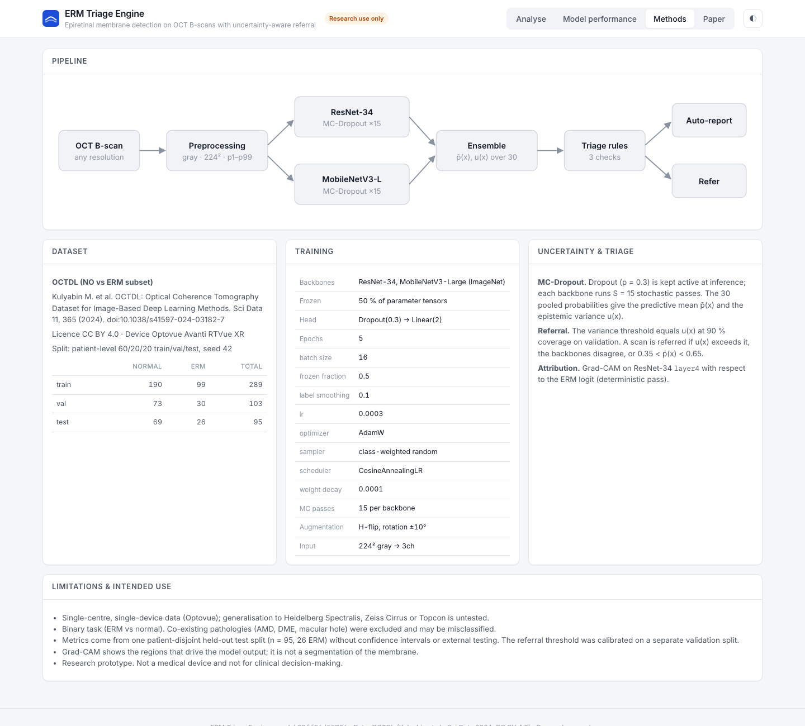
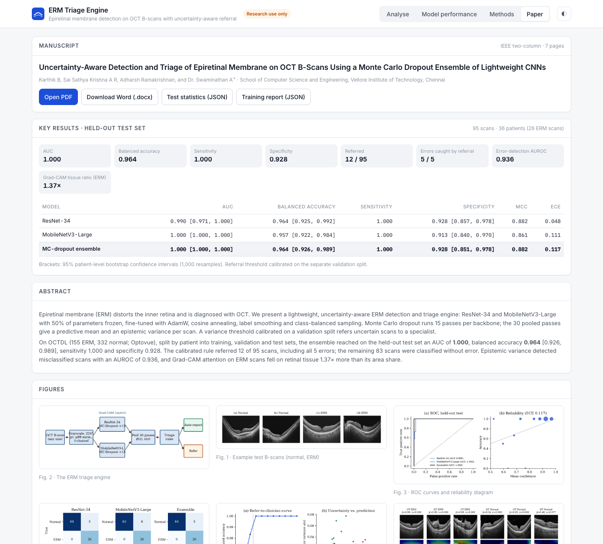

# ERM Triage Engine

> This repository documents the project (description, method, results, screenshots). The source code lives in a private repository, `ERM-Triage-Engine-code`.

**Project site:** [https://kart4206.github.io/ERM-Triage-Engine/](https://kart4206.github.io/ERM-Triage-Engine/)

Detects epiretinal membrane (ERM) on retinal OCT B-scans and decides, scan by scan, whether the result can be reported automatically or should go to a retinal specialist. Two lightweight CNNs run Monte Carlo dropout, and the spread of their 30 stochastic predictions is the uncertainty that drives the referral.

Research software. Not a medical device.

## What it does

- Upload an OCT B-scan (PNG, JPG, TIFF or BMP) or click one of eight held-out test scans.
- Get the classification (ERM or no ERM), P(ERM) with a 95% interval over the stochastic passes, the epistemic variance, entropy and confidence.
- See each backbone's vote, a histogram of all 30 passes and a Grad-CAM attribution map with an opacity slider.
- Read the triage decision and the three checks behind it: variance below the calibrated threshold, backbone agreement, and probability outside the 0.35 to 0.65 band.
- Print a one-page A4 report with a report ID, image hash and model version.
- Browse held-out test metrics, ROC, calibration and referral curves, the method and the figures from the accompanying paper.

## Method

| Stage | Detail |
|---|---|
| Data | OCTDL (Kulyabin et al., *Sci. Data* 2024, CC BY 4.0), normal and ERM classes, Optovue Avanti RTVue XR |
| Split | By patient, 60/20/20: train 190 normal / 99 ERM, validation 73 / 30, test 69 / 26 |
| Preprocessing | Grayscale, 224 × 224, p1 to p99 intensity normalisation, three channels; flips and ±10° rotation for training |
| Backbones | ResNet-34 and MobileNetV3-Large (ImageNet), first 50% of parameters frozen, Dropout(0.3) and a two-way head |
| Training | AdamW (3e-4), cosine annealing, label smoothing 0.1, class-weighted sampling, 5 epochs (about 35 s on an Apple-silicon laptop) |
| Uncertainty | MC dropout, 15 passes per backbone; mean and variance over the 30 pooled passes |
| Referral | Variance threshold at 90% coverage on the validation split, applied unchanged to the test split |
| Explanation | Grad-CAM on ResNet-34 layer4, measured against an Otsu tissue mask |

More detail: [docs/ARCHITECTURE.md](docs/ARCHITECTURE.md).

## Results on the held-out test set

95 scans from 36 patients (26 ERM scans from 14 patients). Brackets are 95% patient-level bootstrap intervals (1,000 resamples).

| Model | AUC | Balanced accuracy | Sensitivity | Specificity | MCC | ECE |
|---|---|---|---|---|---|---|
| ResNet-34 | 0.990 [0.971, 1.000] | 0.964 [0.925, 0.992] | 1.000 | 0.928 [0.857, 0.978] | 0.882 | 0.048 |
| MobileNetV3-Large | 1.000 [1.000, 1.000] | 0.957 [0.922, 0.984] | 1.000 | 0.913 [0.840, 0.970] | 0.861 | 0.111 |
| MC-dropout ensemble | 1.000 [1.000, 1.000] | 0.964 [0.926, 0.989] | 1.000 | 0.928 [0.851, 0.978] | 0.882 | 0.117 |

The validation-calibrated threshold referred 12 of 95 scans. All 5 errors were among them, and the other 83 scans were classified correctly. The variance separates wrong from right predictions with an AUROC of 0.936. On ERM scans, Grad-CAM puts 1.37 times more attribution on retinal tissue than its share of the image.

Full tables and figures: [docs/RESULTS.md](docs/RESULTS.md). The complete write-up is in [docs/REPORT.md](docs/REPORT.md).

## Screenshots

| | |
|---|---|
|  |  |
|  |  |

## Tech stack

Python, PyTorch and torchvision, scikit-learn, Flask, Chart.js. The app runs locally with `python app.py`.

## Limitations

- The test set is small (26 ERM scans), so the perfect AUC and sensitivity come with the intervals above.
- All scans come from one Optovue device; other scanners are untested.
- The task is ERM against normal only. Other macular diseases were not in the training data.
- Grad-CAM shows what drives the output; it is not a segmentation of the membrane.

## Authors

Karthik B, Sai Sathya Krishna A R, Adharsh Ramakrishnan, and Dr. Swaminathan A (corresponding author). School of Computer Science and Engineering, Vellore Institute of Technology, Chennai.
