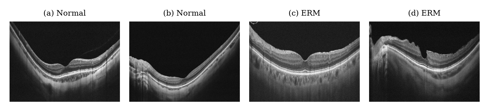
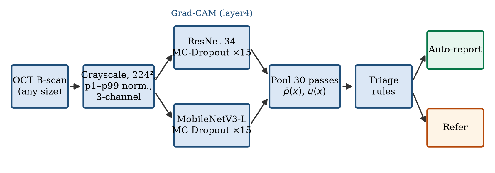
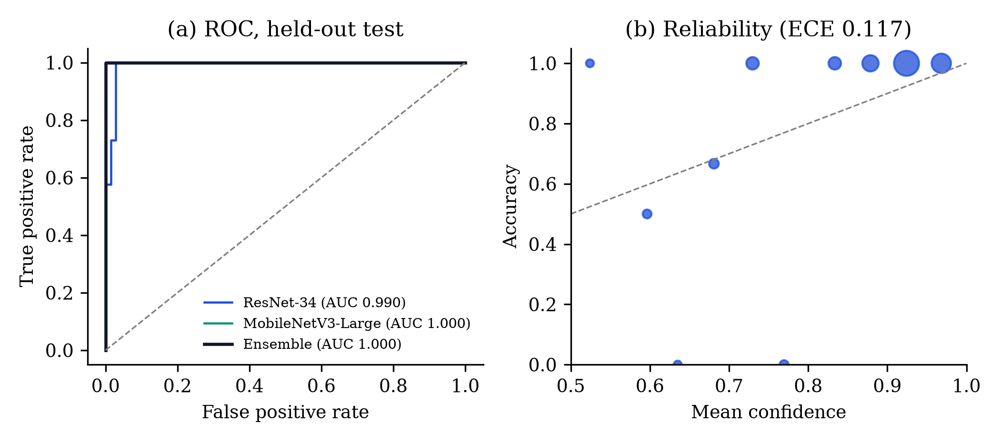
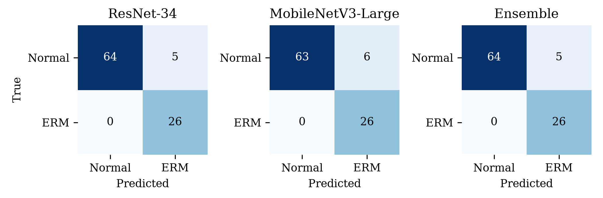
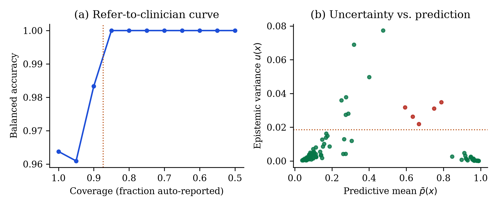
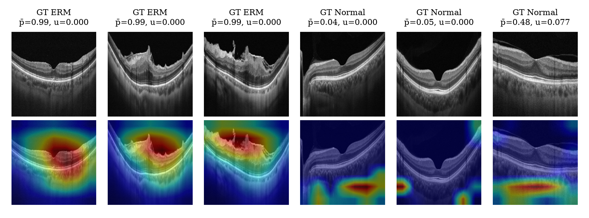
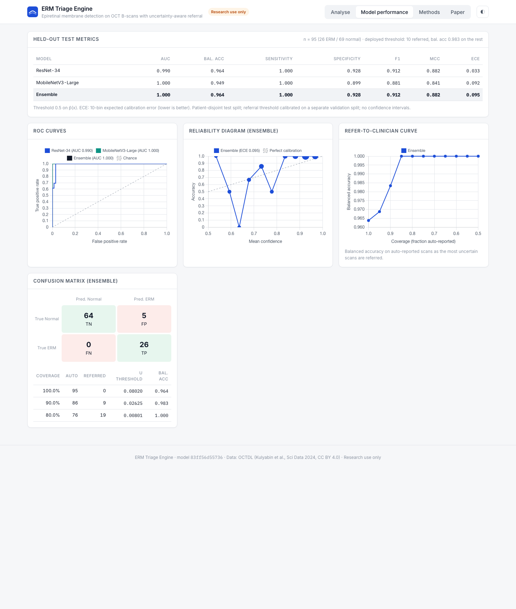

# ERM Triage Engine: project report

**Uncertainty-aware detection and triage of epiretinal membrane on OCT B-scans using a Monte Carlo dropout ensemble of lightweight CNNs**

Karthik B, Sai Sathya Krishna A R, Adharsh Ramakrishnan, and Dr. Swaminathan A (corresponding author)
School of Computer Science and Engineering, Vellore Institute of Technology, Chennai

Research software. Not a medical device.

## Contents

1. Summary
2. Clinical background
3. Problem and objectives
4. Data
5. Method
6. Evaluation protocol
7. Results
8. The application
9. Reproducing the results
10. Limitations
11. Future work
12. References

## 1. Summary

Epiretinal membrane (ERM) is a common disorder of the vitreoretinal interface that wrinkles the inner retina and can blur and distort central vision. It is diagnosed on optical coherence tomography (OCT). This project builds a screening engine that detects ERM on single OCT B-scans and, for each scan, decides whether the result can be reported automatically or should be referred to a retinal specialist.

Two ImageNet-pretrained backbones, ResNet-34 and MobileNetV3-Large, are fine-tuned on the public OCTDL dataset. At inference both keep dropout active and run 15 stochastic passes each. The mean of the 30 pooled probabilities is the prediction and their variance is the uncertainty. A variance threshold is calibrated on a validation split and then applied, unchanged, to a held-out test split of patients the models never saw.

On that test split (95 scans from 36 patients), the ensemble reached an AUC of 1.000, a balanced accuracy of 0.964 (95% patient-level bootstrap interval [0.926, 0.989]), a sensitivity of 1.000 and a specificity of 0.928. The calibrated referral rule sent 12 scans (12.6%) to a specialist. All 5 misclassified scans were among them, and the remaining 83 scans were all classified correctly. Training takes about 35 seconds on an Apple-silicon laptop.

## 2. Clinical background

ERM is a sheet of fibrocellular tissue that grows on the inner surface of the retina at the macula. Most cases are idiopathic and associated with age and posterior vitreous detachment. Secondary ERM follows retinal tears, retinal detachment surgery, uveitis, retinal vascular occlusion or diabetic retinopathy. As the membrane contracts it wrinkles the inner retina and pulls on the fovea, which causes metamorphopsia (distorted vision), blurring and, in advanced cases, reduced visual acuity. Treatment ranges from observation to vitrectomy with membrane peeling, depending on symptoms and the structural stage on OCT.

On an OCT B-scan, ERM appears as a hyperreflective line on, or slightly separated from, the internal limiting membrane. Typical associated signs are surface wrinkling, flattening or loss of the foveal depression, increased central retinal thickness and, later, ectopic inner foveal layers and disorganised inner retina. Early membranes are thin and easy to overlook; advanced membranes are obvious.



*Example test scans: (a), (b) normal maculae with a preserved foveal pit; (c), (d) ERM with a hyperreflective membrane, wrinkling and loss of the foveal contour.*

## 3. Problem and objectives

OCT volumes are acquired far faster than specialists can grade them, so automated screening is attractive. Two problems make many published classifiers hard to trust in practice:

- They are often evaluated on random image-level splits. Several B-scans of one eye are nearly identical, so the same patient appears in both training and test data and the reported accuracy is inflated.
- They return a label for every scan, however unsure they are. A screening tool needs to decide clear cases and pass ambiguous ones to a clinician.

The objectives were therefore to:

1. train a light, fast ERM detector on public data;
2. estimate per-scan uncertainty and turn it into a referral rule;
3. evaluate everything on patients that were never used for training or for choosing thresholds, with confidence intervals;
4. show where the model looks, and package it in a usable application with a per-scan report.

## 4. Data

OCTDL (Kulyabin et al., *Scientific Data*, 2024) is a public collection of more than 2,000 OCT B-scans acquired with an Optovue Avanti RTVue XR device, centred on the fovea and labelled by retinal specialists. It is released under CC BY 4.0 and includes patient identifiers. This project uses its normal (NO) and ERM classes: 332 normal scans from 110 patients and 155 ERM scans from 71 patients.

Patients, not images, were shuffled with a fixed seed (42) within each class and assigned to training, validation and test sets in the proportion 60/20/20. No patient contributes images to more than one set.

| Split | Normal | ERM | Total | Used for |
|---|---|---|---|---|
| Training | 190 | 99 | 289 | Fitting the networks |
| Validation | 73 | 30 | 103 | Calibrating the referral threshold only |
| Test | 69 | 26 | 95 | Every reported metric |

The test set contains 36 patients, 14 of whom have ERM.

## 5. Method



### 5.1 Preprocessing

Each scan is converted to grayscale and resized to 224 × 224 pixels. Intensities are clipped to the image's own 1st and 99th percentiles and rescaled to [0, 1]:

g′ = clip((g − P1) / (P99 − P1), 0, 1)

This removes brightness and contrast differences between scans. The image is then copied into three channels and standardised with ImageNet statistics. During training only, images are flipped horizontally at random and rotated by up to ±10°.

### 5.2 Backbones

| | ResNet-34 | MobileNetV3-Large |
|---|---|---|
| Design | Residual connections | Depthwise-separable blocks found by architecture search |
| Pretraining | ImageNet | ImageNet |
| Frozen | First 50% of parameter tensors | First 50% of parameter tensors |
| Head | Dropout (p = 0.3) → Linear(512, 2) | Linear → Hardswish → Dropout (p = 0.3) → Linear(1280, 2) |

The two architectures make partly different errors, which is what an ensemble needs. Freezing the early layers keeps generic edge and texture filters and limits over-fitting on a small dataset.

### 5.3 Training

| Setting | Value |
|---|---|
| Optimiser | AdamW, learning rate 3 × 10⁻⁴, weight decay 10⁻⁴ |
| Schedule | Cosine annealing over all steps |
| Loss | Cross-entropy with label smoothing 0.1 |
| Class balance | Weighted random sampler, weight 1 / class count |
| Batch size / epochs | 16 / 5 |
| Hardware / time | Apple-silicon laptop (PyTorch MPS) / about 35 s |

### 5.4 Monte Carlo dropout ensemble

At inference, batch normalisation stays in evaluation mode while dropout stays active. Each backbone runs S = 15 passes with independent dropout masks. With p_m^(s)(x) the ERM probability of backbone m on pass s, the 30 pooled passes give

- the predictive mean p̄(x) = (1 / 2S) Σ_m Σ_s p_m^(s)(x), which decides the class at 0.5;
- the epistemic variance u(x) = (1 / 2S) Σ_m Σ_s (p_m^(s)(x) − p̄(x))², which captures both dropout noise within a model and disagreement between the two models;
- a 95% predictive interval from the 2.5th and 97.5th percentiles of the passes.

### 5.5 Triage rule

The referral threshold τ is the variance below which the 90% most certain validation scans fall (τ = 0.0219 in the released model). It is fixed after calibration and applied unchanged to the test split. The application refers a scan when any of three checks fails:

1. u(x) > τ;
2. the two backbones disagree on the class;
3. 0.35 < p̄(x) < 0.65.

The quantitative analysis below evaluates the variance rule on its own, because that is the part calibrated on separate data.

### 5.6 Explainability

Grad-CAM is computed for the ERM logit of ResNet-34 at its last convolutional stage (layer4). To measure where the model looks, retinal tissue is segmented with Otsu's threshold, and the tissue attention ratio is the share of Grad-CAM mass on tissue divided by the share of the image that tissue covers. A ratio above 1 means attention concentrates on the retina more than its area alone would explain.

## 6. Evaluation protocol

- **Patient-disjoint splits.** No patient appears in more than one split.
- **Threshold on validation only.** τ is chosen on the validation split; the test split is touched once, for the final numbers.
- **Metrics.** AUC, balanced accuracy, sensitivity, specificity, F1, Matthews correlation coefficient (MCC) and expected calibration error (ECE, 10 bins), with ERM as the positive class.
- **Confidence intervals.** 95% intervals from a patient-level bootstrap with 1,000 resamples. Patients, not images, are resampled, because scans of one patient are not independent.
- **Reproducibility.** MC-dropout sampling in the analysis is seeded, and every number and figure is generated from saved predictions.

## 7. Results

### 7.1 Detection

| Model | AUC | Balanced accuracy | Sensitivity | Specificity | F1 | MCC | ECE |
|---|---|---|---|---|---|---|---|
| ResNet-34 | 0.990 | 0.964 | 1.000 | 0.928 | 0.912 | 0.882 | 0.048 |
| MobileNetV3-Large | 1.000 | 0.957 | 1.000 | 0.913 | 0.897 | 0.861 | 0.111 |
| MC-dropout ensemble | 1.000 | 0.964 | 1.000 | 0.928 | 0.912 | 0.882 | 0.117 |

95% patient-level bootstrap intervals:

| Model | AUC | Balanced accuracy | Sensitivity | Specificity |
|---|---|---|---|---|
| ResNet-34 | [0.971, 1.000] | [0.925, 0.992] | [1.000, 1.000] | [0.857, 0.978] |
| MobileNetV3-Large | [1.000, 1.000] | [0.922, 0.984] | [1.000, 1.000] | [0.840, 0.970] |
| MC-dropout ensemble | [1.000, 1.000] | [0.926, 0.989] | [1.000, 1.000] | [0.851, 0.978] |





The ensemble found all 26 ERM scans and correctly classified 64 of 69 normal scans. Every ERM scan received a higher ERM probability than every normal scan, so the 5 errors are all false positives near the decision threshold. ResNet-34 alone had the same confusion matrix; MobileNetV3-Large had 6 false positives. The two backbones agreed on 94.7% of test scans. On the validation split the ensemble reached an AUC of 0.992 and a balanced accuracy of 0.933, consistent with the test results.

The intervals matter more than the point estimates here. The sensitivity interval is stuck at 1.000 because no ERM scan was missed in any resample, which reflects the 14 ERM patients available rather than proving perfect sensitivity. The specificity interval, [0.851, 0.978], is the most realistic picture of the remaining uncertainty. ResNet-34 was the best calibrated model (ECE 0.048); averaging it with the less extreme MobileNetV3-Large raised the ensemble ECE to 0.117, and the reliability diagram shows the ensemble is somewhat under-confident in its middle bins, a known effect of label smoothing and averaging.

### 7.2 Uncertainty and referral

| Coverage | Auto-reported | Referred | Balanced accuracy |
|---|---|---|---|
| 100% | 95 | 0 | 0.964 |
| 95% | 90 | 5 | 0.961 |
| 90% | 86 | 9 | 0.983 |
| 85% | 81 | 14 | 1.000 |
| 80% | 76 | 19 | 1.000 |
| 70% | 66 | 29 | 1.000 |
| Calibrated τ | 83 | 12 | 1.000 |



The validation-calibrated threshold referred 12 of 95 test scans. All 5 errors were among them, and the 83 automatically reported scans (26 ERM, 57 normal) were all correct. The right-hand plot shows why: the misclassified scans sit at intermediate probabilities with high variance, well apart from the correct ones. Mean variance was 0.0291 on misclassified scans and 0.0065 on correct ones, and the variance identified misclassified scans with an AUROC of 0.936.

The small dip at 95% coverage happens because the very most uncertain scans include a few correctly classified normal scans near the boundary; removing them shifts the class balance before the errors are reached.

### 7.3 Where the model looks



For ERM scans, Grad-CAM concentrates on the inner retinal surface: the membrane, the wrinkled inner retina and the distorted foveal contour, which are the features a clinician looks for.

| Scans | Tissue attention ratio |
|---|---|
| ERM | 1.37 |
| Normal | 0.50 |
| All | 0.74 |

On ERM scans the attribution falls on retinal tissue 1.37 times more than tissue's share of the image. On normal scans the ratio is below 1: the map explains the ERM score, a normal scan offers little evidence for it, and the leftover attribution lands on the choroid and the image borders. The most uncertain test scan, a normal eye with p̄ = 0.48, shows diffuse attribution below the retina, which fits its referral.

## 8. The application

The project ships a Flask web application with four tabs:

- **Analyse:** upload a B-scan or pick one of eight held-out test scans. The page shows the input and the Grad-CAM overlay with an opacity slider, the classification, P(ERM) with its 95% interval, variance against the threshold, entropy and confidence, each backbone's probability and vote, a histogram of the 30 passes, the three triage checks, and the ground truth for sample scans.
- **Model performance:** the held-out metrics, ROC, reliability and referral curves and the confusion matrix.
- **Methods:** pipeline diagram, dataset, hyperparameters and limitations.
- **Paper:** key results, abstract and figures.

A **Generate report** button produces a one-page A4 report with a report ID, timestamp, image SHA-256 hash, model version, both images, all findings, the triage checks and the validation summary, ready to save as PDF. Uploaded images are processed in memory and never stored.




## 9. Reproducing the results

```bash
python3 -m venv .venv && source .venv/bin/activate
pip install -r requirements.txt
python prepare_octdl.py raw_octdl/OCTDL.zip raw_octdl/OCTDL_labels.csv   # patient-level 60/20/20 split
python erm_engine.py --epochs 5                                           # train, calibrate, test (about 35 s)
python make_samples.py                                                    # 8 demo scans from the test split
python paper_analysis.py                                                  # bootstrap CIs, referral analysis, figures
python app.py                                                             # http://127.0.0.1:5050
```

OCTDL is available from Mendeley Data (doi 10.17632/sncdhf53xc.4).

## 10. Limitations

- **Small test set.** 95 scans from 36 patients, 14 with ERM. Perfect AUC and sensitivity on this sample do not mean perfect performance in general.
- **One device and centre.** All scans come from one Optovue device. Heidelberg Spectralis, Zeiss Cirrus and Topcon scans are untested.
- **Binary task.** Only ERM and normal scans were used. In practice ERM coexists with other macular diseases the model has never seen.
- **No staging.** The model detects ERM but does not grade its severity.
- **One split.** Results come from a single patient-level split; repeated cross-validation would show how much they depend on the split.
- **Attribution, not segmentation.** Grad-CAM shows what drives the output; it does not outline the membrane.

## 11. Future work

- External validation on multi-centre, multi-device data.
- Multi-class OCT diagnosis and ERM staging.
- Retinal foundation models and volume-level aggregation across B-scans.
- A reader study measuring how uncertainty-based referral changes clinician workload and accuracy.

## 12. References

1. M. Kulyabin et al., "OCTDL: Optical coherence tomography dataset for image-based deep learning methods," *Sci. Data*, vol. 11, 365, 2024.
2. A. T. Fung, J. Galvin and T. Tran, "Epiretinal membrane: A review," *Clin. Exp. Ophthalmol.*, vol. 49, no. 3, pp. 289–308, 2021.
3. A. Govetto et al., "Insights into epiretinal membranes: Presence of ectopic inner foveal layers and a new optical coherence tomography staging scheme," *Am. J. Ophthalmol.*, vol. 175, pp. 99–113, 2017.
4. Y. Gal and Z. Ghahramani, "Dropout as a Bayesian approximation: Representing model uncertainty in deep learning," in *Proc. ICML*, 2016, pp. 1050–1059.
5. C. Leibig et al., "Leveraging uncertainty information from deep neural networks for disease detection," *Sci. Rep.*, vol. 7, 17816, 2017.
6. Y. Geifman and R. El-Yaniv, "Selective classification for deep neural networks," in *Proc. NeurIPS*, 2017, pp. 4878–4887.
7. R. R. Selvaraju et al., "Grad-CAM: Visual explanations from deep networks via gradient-based localization," in *Proc. ICCV*, 2017, pp. 618–626.
8. K. He, X. Zhang, S. Ren and J. Sun, "Deep residual learning for image recognition," in *Proc. CVPR*, 2016, pp. 770–778.
9. A. Howard et al., "Searching for MobileNetV3," in *Proc. ICCV*, 2019, pp. 1314–1324.
10. D. S. Kermany et al., "Identifying medical diagnoses and treatable diseases by image-based deep learning," *Cell*, vol. 172, no. 5, pp. 1122–1131, 2018.
11. G. Varoquaux and V. Cheplygina, "Machine learning for medical imaging: Methodological failures and recommendations for the future," *npj Digit. Med.*, vol. 5, 48, 2022.
